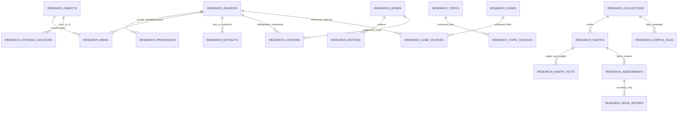

# Local research catalogue

The catalogue is independent of the old AI-classification database. It imports the verified local archive and the downloaded hadith datasets without changing the original files. It requires no API keys, network services, paid extraction, or running application backend.

## Storage layout

- `data/research/research.sqlite3`: local relational database, owner-readable/writable only.
- `../telegram-archive/kkee9938/`: original media and archival SQLite snapshot; read-only import source.
- `data/hadiths/`: original Arabic/English JSON files; read-only import source.
- `data/research/backups/`: consistent, verified SQLite backups.
- `data/research/export/`: PostgreSQL schema, JSONL table data, checksums, and the R2 upload plan. This directory is private and ignored by Git.
- `frontend/src/content/`: public read-only website projections generated from the catalogue. No account credentials or raw discussion payloads are included.

The 21 GB of original attachments are not copied into SQLite. Media records point to content objects by SHA-256; storage locations are separate records. The 1,907 attachment occurrences resolve to 1,805 distinct content objects. All occurrences, filenames, and album membership are retained.



## Data boundaries

- **Collection history:** original text/payloads live in `research_provenance`. Their collection origin is internal provenance, not a scholarly citation. Private provenance is omitted from portable/public projections.
- **Original files:** `research_media` preserves each attachment occurrence. `research_objects` deduplicates bytes, and `research_storage_locations` separates current local paths from planned R2 object keys.
- **Book identification:** works, editions, and citations are separate records. Only the two previously inspected page sources have provisional identification. Unknown author/edition fields remain null. No automatic identification is presented as verified.
- **Albums:** membership derives only from the original album ID. Adjacency is never used to invent a book or album association.
- **Extracted text:** collection quote fragments and manually checked partial quotes have distinct extraction kinds and review states. Later OCR and speech passes are recorded below; their automatic outputs do not become verified quotations or hadith rulings.
- **Research links:** keyword matches and selected references remain proposed links. Counts are not authentication verdicts.
- **Hadith corpus:** 36,390 Arabic entries and 72,780 Arabic/English text rows are preserved, including empty texts. Original grades/reference fields remain inside each row's original data. All 14 source-file metadata blocks and hashes are preserved. Arabic/English entries are paired by collection and exact source number, never by guessed text similarity.
- **Narrators and rulings:** narrator identities/judgments have separate tables and require citations. No narrator classifications, hadith verdicts, or final book entries have been invented by import.

## Setup and commands

From the repository root:

```sh
python3 -m venv .research-venv
.research-venv/bin/python -m pip install -r scripts/requirements-research.txt
.research-venv/bin/python scripts/research_db.py import
.research-venv/bin/python scripts/research_db.py audit
.research-venv/bin/python scripts/research_db.py backup
.research-venv/bin/python scripts/research_db.py export
.research-venv/bin/python scripts/research_db.py project
```

`--database`, `--archive`, and `--output` select alternate local paths. `project` uses `--output` as its snapshot directory. `export` writes migration artifacts there; it does not upload or publish anything. `backup` refuses to overwrite an existing backup file.

Import uses deterministic UUIDs and stable content keys. Re-running the same import does not duplicate rows. Existing editorial titles, reviews, and assessments are not overwritten. Import is additive: removing a lexical match from a later extraction does not silently erase an already stored research relationship. Deliberate editorial edits/retractions belong in the catalogue and its review workflow. Original collection payload changes create additional provenance versions, not replacement originals.

The site imports the database-generated `editorial-seed.json`, `archive-index.json`, `local-sources.json`, and `archive-themes.json`. It currently serves these read-only projections rather than opening SQLite on every page view. After catalogue changes, run `project` and rebuild/restart the website. The frontend content files are snapshots, not a second editorial database.

The original `analyze_archive_topics.py` and `index_local_sources.py` remain bootstrap/extraction tools; their outputs can seed an import. Do not treat their output as an automatic overwrite of reviewed catalogue records.

## Schema versions and review guards

The catalogue tracks applied schema versions. Baseline v1 establishes the normalized tables. Version 2 tightens book-entry references: a book entry must point to an accepted assessment of the same hadith. Accepted/rejected assessments require a reviewer and review date; approved book entries require their own review fields. The bootstrap upgrade rebuilds the old book table only if it is empty; it refuses to discard existing book entries. Unknown future schema versions are rejected.

These are database integrity guards, not a completed authentication/reviewer-management application. All imported hadith entries are unreviewed, all method layers are proposed, and no final book entries or assessments are created.

## Later PostgreSQL / Supabase and Cloudflare R2 migration

The portable export contains:

1. `postgresql-schema.sql`: PostgreSQL-compatible baseline with foreign keys, unique/check constraints, and RLS enabled. No anonymous public policies are installed.
2. One JSONL file per exported table, plus row counts and SHA-256 checksums in `manifest.json`.
3. `r2-upload-manifest.jsonl`: one row per unique object, with its relative local path, planned object key, MIME type, size, and SHA-256. Every upload is marked `not_uploaded`.

R2 keys use `originals/sha256/<first-two-hash-characters>/<full-hash>`. Their identity does not depend on the current disk folder, book title, or collection-message number. Send the MIME type as object metadata when uploading. A local location is `available`; an R2 location is only `planned` until upload and verification succeed. No bucket name or public URL is invented.

The export omits raw provenance/import manifests and local storage-location rows. The media table's optional legacy local-path field is null in cloud exports. Content identity, topic/source relationships, source references, editions, and hadith IDs remain unchanged. JSONL files are structured data exports, not commands to execute verbatim as SQL; load them through a typed importer in dependency order.

The schema and full portable dataset have been rehearsed in a disposable local PostgreSQL container. Cloud resource provisioning, actual R2 uploads, PostgreSQL production import, authorization policies, and replacing the local media adapter remain explicit later steps. Neither the user's existing PostgreSQL database nor any cloud account is touched by these commands.

## Checks

```sh
PYTHONPATH=backend .research-venv/bin/python -m unittest backend.tests.test_research_catalogue -v
```

Checks cover import idempotence, corpus completeness, duplicate bytes versus distinct occurrences, album reconstruction, absence of private provenance in projections, full export restore with foreign-key validation, preservation of editorial edits, and review/book-entry constraints. Files are checked for existence and size on import/audit; their original SHA-256 verification report is retained in the archive. A new full byte-for-byte rehash is not implied by each catalogue import.

A PostgreSQL migration rehearsal can be repeated in a newly created, isolated test container using `scripts/validate_postgres_export.py --container <disposable-name> --export-dir data/research/export`. The validator creates a fresh validation schema, applies the baseline, imports all exported rows, and checks counts. Never point the validator at a production container.

### Reader-facing evidence and local OCR (2026-10-21)

`research_catalogue_settings.public_evidence` contains a conservative, visually inspected selection of **individual media IDs per case** and descriptive labels. `project` emits `public-evidence.json`. Keyword suggestions remain internal; they no longer drive public topic galleries. Topic galleries combine only their cases' selected images. Album membership does not establish subject relevance. This initial selection covers 14 images; other cases intentionally await evidence review. Selection verifies subject relevance, not the historical argument or hadith grading.

Run local OCR without an API:

```sh
python3 scripts/ocr_research.py --ids 195 196 344 1315 1316 2380 2381 --limit 7
python3 scripts/ocr_research.py --limit 50 --workers 2
```

Requires `tesseract-ocr` and Arabic/English language data. The script checks input hashes, backs up the catalogue first, deduplicates processing by object, skips completed jobs, and stores `ocr_text` extracts with `review_state=unverified`. Originals and existing manual quotes remain untouched. Initial OCR has missing and garbled words, especially around highlights, watermarks and overlaid covers; it is not suitable for automatic quotation, bibliographic identification or hadith judgments. OCR output is private until corrected against the image. The first full image pass completed on 2026-10-21: all 1,278 unique image objects processed; 1,179 yielded nonempty text and 99 yielded none. See `data/research/ocr-report.json` for exact current totals. Further text correction, bibliographic identification and gallery curation remain editorial work; the later transcription pass is recorded below.

### Evidence readings (2026-10-21)

`research_catalogue_settings.evidence_analysis` now stores an editorial reading for each of the 14 selected scans, plus a combined reading for `uthman-siege`. Its `public` portion becomes `evidence-analysis.json`; caption provenance and editorial review metadata remain outside the frontend projection. Each reading separates a description of the page, short visually checked excerpts with speaker attribution, the argument drawn from it, and limitations of the inference. These are edited paraphrases informed by the collected captions and checked against each original image, not raw OCR or verbatim posts. Their state remains `editorial_draft`; no hadith assessments or scholarly publication approvals were created.

`EvidenceReading` renders next to the actual image in case/topic galleries, source pages and individual library pages. The gallery continues to use only explicitly selected media IDs, and integration checks ensure a case cannot silently show another case's analysis. The siege reading distinguishes participation in the siege from direct killing, and later office-holding from a proven prior order. Other corrections distinguish author text from editorial footnotes, transmission of a weakening opinion from adopting it, and criticism of a specific route from rejection of all routes.

Public presentation update: at the owner's request, the separate limitations block is no longer rendered. The original qualification notes remain preserved in the catalogue for internal editorial review; source text, attributions and argument wording are unchanged.

### Arabic media catalogue (2026-10-28)

All 1,805 unique objects have descriptive Arabic metadata based on original images,
saved OCR, actual album captions, PDF/document extraction or full speech transcripts.
Prior visually checked evidence readings remain authoritative editorial inputs for
their descriptions. Automatic crosschecks are metadata checks, not human scholarly
approval. Full books/volumes, independent papers, extracted pages and recordings are
distinguished; filenames do not establish bibliographic identity or completeness.

All 349 unique video/audio objects (about 28 hours) were transcribed with segment and
word times. Raw Arabic transcripts are stored as `speech_transcript` extracts with
`review_state=unverified`; caches retain full timing and processing provenance.
Selected public transcripts include conservative spelling corrections, visible
automatic-transcription labels, searchable text and downloadable WebVTT captions.

The initial public selection has 992 canonical research items, including 188
recordings with transcripts and 41 thematic playback sections. The 102 duplicate
attachment occurrences resolve to their canonical library pages. Nonselected,
uncertain and purely satirical material stays out of public catalogue browsing;
original objects and source occurrences are preserved. Similar PDF covers with
different contents are not silently merged. See the private publication report at
`data/research/enrichment/publication-report.json` for the current counts.

`research_catalogue_settings.media_catalogue` retains separate public and editorial
sections. The website's restricted views expose public metadata and selected
transcript text only; raw captions, selection reasons and original discussion
provenance remain inaccessible. Local backups precede synchronization, and the
portable export was compared with Neon after publication. No narration assessment,
narrator judgment or approved book entry was added by this metadata workflow.

### Additional Telegram import comparison

`scripts/filter_telegram_import.py` compares the preserved `muawiya4n` archive
against the existing catalogue using only local processing. Results live in the
private, ignored `data/research/imports/muawiya4n/` staging directory. Its separate
post namespace avoids collisions with the original archive's legacy numeric IDs.
It does not change public listings or the production catalogue.

The staging database retains every post payload and text. Explanation associations
record own captions, actual album membership and explicit replies, each marked
unverified. Adjacency alone creates no association. Exact content hashes consolidate
staging file identities and map to existing catalogue media; canonical explanation
views retain text from all occurrences. Similar image hashes only create visual
review candidates, never deletion or automatic edition selection. PDF page counts
and locally extracted text are cached; image-only PDFs still require OCR and page
inspection. No paid API calls occur. Re-running reuses inspections and stable keys.

`review_telegram_images.py` creates private numbered contact sheets for the fixed
image-candidate set. Visual observations are preserved beside those sheets.
`apply_telegram_visual_review.py` saves explicit Codex visual decisions and
append-only decision history, with a consistent pre-change SQLite backup. It checks
that distinct works/volumes and annotation variants cannot become connected through
a transitive duplicate group. Same-page groups retain original files and every
source/explanation association. Quality preferences follow enlarged visual detail
comparison; equivalent scans retain the existing identity where possible. No
scholarly approval or public/production update follows from a visual decision.
The filtering command preserves existing candidate review states on subsequent runs.

`prepare_telegram_pdf_review.py` renders all imported PDF pages for a separate
layout/readability screen. Private `visual-review/pdf/review.json` and
`pdf_visual_reviews` distinguish annotated excerpt compilations from an authored
lecture booklet. Successful rendering and a visual page screen do not certify
bibliographic completeness; inserted covers and annotations can obscure underlying
source text. Image-only PDFs still require OCR for text search and textual checking.

### Source additions and thematic explanations (November 2026)

The `muawiya4n` import uses source/media IDs `1,000,000 + original message ID` and
channel-scoped source UUIDs, avoiding collisions with the earlier archive. All
1,686 source posts, 1,428 attachment occurrences and 834 nonempty source texts are
preserved. Consolidation retains 1,798 caption/album/reply associations. Byte-identical
local copies share storage through verified atomic hard links; distinct editions,
annotation variants and archived originals are preserved.

`ocr_telegram_additions.py` runs only local Arabic/English Tesseract, caching by
verified input hash. All 1,340 unique image/PDF inputs were processed or reused;
image-only PDFs receive page-level OCR. OCR remains explicitly unverified.
`prepare_telegram_publication.py` creates edited Arabic subject summaries and
source-backed thematic links. Raw comments, polemical language, account payloads,
selection reasons and OCR processing provenance are not public metadata. The
public explanations are attributed paraphrases of the source's argument, separate
from the displayed document and from scholarly assessments.

The initial published projection includes 559 new items (14 PDFs and 545 scans),
30 thematic bundles and 9 clearer replacements for existing public images. Other
candidate items stay private pending context/identification or separate recording
review. Existing video visibility is preserved, including all 57 hidden videos.

`publish_telegram_additions.py` backs up SQLite and the remote public catalogue,
then adds namespaced relational records and merges only the reviewed public
projection. Cloud writes use one transaction and verify the unchanged video
review decisions. Full source payloads are stored only in the private provenance
table, which remains inaccessible to the website reader. `telegram-additions-view.sql`
exposes OCR text only for visible canonical documents. `/themes` groups proofs
under edited explanations; document/source pages show attributed commentary and
library search includes document OCR. Existing library IDs and original media
endpoints remain valid; preferred clearer images have separate source IDs.

Validation: `scripts/check-telegram-publication.py` verifies source/text/link
preservation and publication boundaries. `frontend/scripts/check-research-additions.mjs`
checks thematic navigation, all new PDF routes, OCR search and duplicate redirects.
Normal research, catalogue, proof-link and security checks also apply.

Public reads use private, RLS-protected relational read tables populated once per
publication by `materialize_public_catalogue.py`. Website views apply the existing
visibility decisions over those small rows. This avoids expanding the entire
catalogue/transcript JSON per request; migration checks compare all public metadata,
transcripts and document text before and after the change. The public reader has
no direct access to these base tables or raw provenance. Legacy catalogue refreshes
preserve the separately reviewed imported entries and their explanations.

### Unified hadith search and reading

Homepage search (`/explore`) shows matching hadiths directly before related topic
and library results. The same read-only search supports `/corpus`, with the main
form before the optional inventory/review statistics. Users can enter words,
Western/Eastern/Persian digits, or a book name and number such as `البخاري 1`.
Numeric input matches both the collection record number and its supplied Arabic
reference number; numbering differences remain visible. Query punctuation and
vocalization are ignored without altering source texts. Interface numbers use
Western digits. `/corpus/[collection]/[number]` provides a shareable full-text reader
with references and separate source grades/project review state. Legacy `/search`
links retain their query when redirected to `/corpus`. No backend AI/API is needed.
Run `npm run check:hadith-search` against a running edition to test the homepage
form destination, number/word search, digit variants, reading links and references.

### Supplementary JSON books in R2

`scripts/sync_missing_hadith_books.py` compares the corpus collection slugs with
AhmedBaset/hadith-json's `db/by_book` files at pinned revision
`70b83d6d21995bb32f8d7271cd75501be5a922a7`. Its default mode downloads and validates
missing collections locally; `--upload` archives them in the project's R2 bucket.
Original JSON bytes and dataset numbering are preserved. Git blob checksums,
record counts, book associations, unique local numbers and Arabic text fields
are checked before uploading, and uploaded bytes are downloaded and SHA-256
verified. Existing identical objects are reused; differing objects are never
overwritten.

Source JSON and Arabic coverage metadata live below
`othmani/datasets/hadith-json/<revision>/`. A content-addressed JSON index under
`indexes/` lists each book's R2 key, source revision, record count and checksum.
Local receipts are ignored under `data/research/source-checks/ahmed-baset/`.
The current supplement contains ten books / 14,721 records, including the
previously archived partial Musnad Ahmad (1,374 records, sections 8–30 missing).
Coverage of other books is recorded as not independently verified.

These immutable source archives are retained independently of the searchable
corpus. Their original status fields describe archive creation time. Public HTTP
delivery may deny JSON paths; storage verification uses authenticated R2 reads,
independently of the website search route.


### Searchable supplementary collections

`scripts/import_supplementary_hadith_books.py --sync-cloud` validates the saved R2
index checksums and imports its ten supplementary collections into local SQLite
and the existing restricted Neon corpus views. It backs up SQLite, uses
transactional additive inserts with deterministic IDs, compares imported rows
with their expected contents in both databases, and confirms the existing
collections retain their record counts. Repeated runs reuse identical records;
differing existing records cause verification failure rather than replacement.
Original Arabic and English text, book sections, dataset-local numbers, source
revision, raw-file SHA-256 and R2 keys remain linked. Literal Unicode escape
artifacts are decoded for reading/search; original JSON stays unchanged in R2.

The corpus now has 17 collections and 51,111 records (50,703 with Arabic text).
The ten additions contribute 14,721 records, all initially unreviewed. They do
not create acceptance/rejection decisions or alter the 200 Bukhari AI drafts.
`corpus-coverage.json` supplies public coverage notes, including Musnad Ahmad's
missing sections 8–30 and the distinction between dataset and printed numbering.
The importer also writes Arabic/English fallback files and regenerates corpus
statistics. The statistics panel remains open by default.

Verification: `npm --prefix frontend run check:supplementary-corpus` checks all
ten new book readers, text searches, dataset-number searches, Arabic book aliases,
statistics, coverage notices and preservation of the existing Bukhari report.
