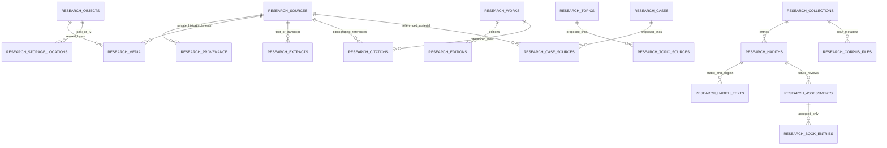

# Local research catalogue

The catalogue is independent of the old AI-classification database. It imports the verified local archive and the downloaded hadith datasets without changing the original files. It requires no API keys, network services, paid extraction, or running application backend.

## Storage layout

- `data/research/research.sqlite3`: local relational database, owner-readable/writable only.
- `../telegram-archive/kkee9938/`: original media and archival SQLite snapshot; read-only import source.
- `data/hadiths/`: original Arabic/English JSON files; read-only import source.
- `data/research/backups/`: consistent, verified SQLite backups.
- `data/research/export/`: PostgreSQL schema, JSONL table data, checksums, and the R2 upload plan. This directory is private and ignored by Git.
- `frontend/src/content/`: public read-only website projections generated from the catalogue. No account credentials or raw discussion payloads are included.

The 21 GB of original attachments are not copied into SQLite. Media records point to content objects by SHA-256; storage locations are separate records. The 1,907 attachment occurrences resolve to 1,805 distinct content objects. All occurrences, filenames, and album membership are retained.



## Data boundaries

- **Collection history:** original text/payloads live in `research_provenance`. Their collection origin is internal provenance, not a scholarly citation. Private provenance is omitted from portable/public projections.
- **Original files:** `research_media` preserves each attachment occurrence. `research_objects` deduplicates bytes, and `research_storage_locations` separates current local paths from planned R2 object keys.
- **Book identification:** works, editions, and citations are separate records. Only the two previously inspected page sources have provisional identification. Unknown author/edition fields remain null. No automatic identification is presented as verified.
- **Albums:** membership derives only from the original album ID. Adjacency is never used to invent a book or album association.
- **Extracted text:** collection quote fragments and the two manually checked partial quotes have distinct extraction kinds and review states. OCR, PDF extraction, and speech transcription have dedicated job/extraction tables but have not been run or queued.
- **Research links:** keyword matches and selected references remain proposed links. Counts are not authentication verdicts.
- **Hadith corpus:** 36,390 Arabic entries and 72,780 Arabic/English text rows are preserved, including empty texts. Original grades/reference fields remain inside each row's original data. All 14 source-file metadata blocks and hashes are preserved. Arabic/English entries are paired by collection and exact source number, never by guessed text similarity.
- **Narrators and rulings:** narrator identities/judgments have separate tables and require citations. No narrator classifications, hadith verdicts, or final book entries have been invented by import.

## Setup and commands

From the repository root:

```sh
python3 -m venv .research-venv
.research-venv/bin/python -m pip install -r scripts/requirements-research.txt
.research-venv/bin/python scripts/research_db.py import
.research-venv/bin/python scripts/research_db.py audit
.research-venv/bin/python scripts/research_db.py backup
.research-venv/bin/python scripts/research_db.py export
.research-venv/bin/python scripts/research_db.py project
```

`--database`, `--archive`, and `--output` select alternate local paths. `project` uses `--output` as its snapshot directory. `export` writes migration artifacts there; it does not upload or publish anything. `backup` refuses to overwrite an existing backup file.

Import uses deterministic UUIDs and stable content keys. Re-running the same import does not duplicate rows. Existing editorial titles, reviews, and assessments are not overwritten. Import is additive: removing a lexical match from a later extraction does not silently erase an already stored research relationship. Deliberate editorial edits/retractions belong in the catalogue and its review workflow. Original collection payload changes create additional provenance versions, not replacement originals.

The site imports the database-generated `editorial-seed.json`, `archive-index.json`, `local-sources.json`, and `archive-themes.json`. It currently serves these read-only projections rather than opening SQLite on every page view. After catalogue changes, run `project` and rebuild/restart the website. The frontend content files are snapshots, not a second editorial database.

The original `analyze_archive_topics.py` and `index_local_sources.py` remain bootstrap/extraction tools; their outputs can seed an import. Do not treat their output as an automatic overwrite of reviewed catalogue records.

## Schema versions and review guards

The catalogue tracks applied schema versions. Baseline v1 establishes the normalized tables. Version 2 tightens book-entry references: a book entry must point to an accepted assessment of the same hadith. Accepted/rejected assessments require a reviewer and review date; approved book entries require their own review fields. The bootstrap upgrade rebuilds the old book table only if it is empty; it refuses to discard existing book entries. Unknown future schema versions are rejected.

These are database integrity guards, not a completed authentication/reviewer-management application. All imported hadith entries are unreviewed, all method layers are proposed, and no final book entries or assessments are created.

## Later PostgreSQL / Supabase and Cloudflare R2 migration

The portable export contains:

1. `postgresql-schema.sql`: PostgreSQL-compatible baseline with foreign keys, unique/check constraints, and RLS enabled. No anonymous public policies are installed.
2. One JSONL file per exported table, plus row counts and SHA-256 checksums in `manifest.json`.
3. `r2-upload-manifest.jsonl`: one row per unique object, with its relative local path, planned object key, MIME type, size, and SHA-256. Every upload is marked `not_uploaded`.

R2 keys use `originals/sha256/<first-two-hash-characters>/<full-hash>`. Their identity does not depend on the current disk folder, book title, or collection-message number. Send the MIME type as object metadata when uploading. A local location is `available`; an R2 location is only `planned` until upload and verification succeed. No bucket name or public URL is invented.

The export omits raw provenance/import manifests and local storage-location rows. The media table's optional legacy local-path field is null in cloud exports. Content identity, topic/source relationships, source references, editions, and hadith IDs remain unchanged. JSONL files are structured data exports, not commands to execute verbatim as SQL; load them through a typed importer in dependency order.

The schema and full portable dataset have been rehearsed in a disposable local PostgreSQL container. Cloud resource provisioning, actual R2 uploads, PostgreSQL production import, authorization policies, and replacing the local media adapter remain explicit later steps. Neither the user's existing PostgreSQL database nor any cloud account is touched by these commands.

## Checks

```sh
PYTHONPATH=backend .research-venv/bin/python -m unittest backend.tests.test_research_catalogue -v
```

Checks cover import idempotence, corpus completeness, duplicate bytes versus distinct occurrences, album reconstruction, absence of private provenance in projections, full export restore with foreign-key validation, preservation of editorial edits, and review/book-entry constraints. Files are checked for existence and size on import/audit; their original SHA-256 verification report is retained in the archive. A new full byte-for-byte rehash is not implied by each catalogue import.

A PostgreSQL migration rehearsal can be repeated in a newly created, isolated test container using `scripts/validate_postgres_export.py --container <disposable-name> --export-dir data/research/export`. The validator creates a fresh validation schema, applies the baseline, imports all exported rows, and checks counts. Never point the validator at a production container.

### Reader-facing evidence and local OCR (2026-10-21)

`research_catalogue_settings.public_evidence` contains a conservative, visually inspected selection of **individual media IDs per case** and descriptive labels. `project` emits `public-evidence.json`. Keyword suggestions remain internal; they no longer drive public topic galleries. Topic galleries combine only their cases' selected images. Album membership does not establish subject relevance. This initial selection covers 14 images; other cases intentionally await evidence review. Selection verifies subject relevance, not the historical argument or hadith grading.

Run local OCR without an API:

```sh
python3 scripts/ocr_research.py --ids 195 196 344 1315 1316 2380 2381 --limit 7
python3 scripts/ocr_research.py --limit 50 --workers 2
```

Requires `tesseract-ocr` and Arabic/English language data. The script checks input hashes, backs up the catalogue first, deduplicates processing by object, skips completed jobs, and stores `ocr_text` extracts with `review_state=unverified`. Originals and existing manual quotes remain untouched. Initial OCR has missing and garbled words, especially around highlights, watermarks and overlaid covers; it is not suitable for automatic quotation, bibliographic identification or hadith judgments. OCR output is private until corrected against the image. The first full image pass completed on 2026-10-21: all 1,278 unique image objects processed; 1,179 yielded nonempty text and 99 yielded none. See `data/research/ocr-report.json` for exact current totals. Text correction, bibliographic identification, further gallery curation and video transcription remain pending.

### Evidence readings (2026-10-21)

`research_catalogue_settings.evidence_analysis` now stores an editorial reading for each of the 14 selected scans, plus a combined reading for `uthman-siege`. Its `public` portion becomes `evidence-analysis.json`; caption provenance and editorial review metadata remain outside the frontend projection. Each reading separates a description of the page, short visually checked excerpts with speaker attribution, the argument drawn from it, and limitations of the inference. These are edited paraphrases informed by the collected captions and checked against each original image, not raw OCR or verbatim posts. Their state remains `editorial_draft`; no hadith assessments or scholarly publication approvals were created.

`EvidenceReading` renders next to the actual image in case/topic galleries, source pages and individual library pages. The gallery continues to use only explicitly selected media IDs, and integration checks ensure a case cannot silently show another case's analysis. The siege reading distinguishes participation in the siege from direct killing, and later office-holding from a proven prior order. Other corrections distinguish author text from editorial footnotes, transmission of a weakening opinion from adopting it, and criticism of a specific route from rejection of all routes.

Public presentation update: at the owner's request, the separate limitations block is no longer rendered. The original qualification notes remain preserved in the catalogue for internal editorial review; source text, attributions and argument wording are unchanged.
